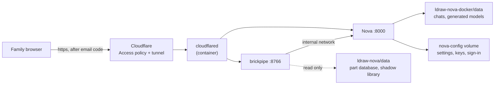

# Hosting brickpipe for the family

One home server runs LDraw Nova, brickpipe and a Cloudflare tunnel. Family
members open `https://bricks.<your domain>` from anywhere, sign in with a
one-time code sent to their email, and use the page exactly as on a laptop.
Nothing is opened on the router and nothing is reachable without that login.

This guide covers the stack itself. Setting up the machine underneath it
(a Debian VM on Proxmox, Docker, the firewall, the Cloudflare tunnel and
the Access login) is in [server-setup.md](server-setup.md).

## What runs where



- **brickpipe** runs *locked*: the server decides where Nova and the part
  libraries are; the page hides those settings. Browsers only choose what
  goes into a run. The server can hold one Rebrickable key for everyone.
- **Nova** has no login of its own and holds your AI provider key or
  Claude sign-in, so it is never published to the network; the tunnel is
  the only way in, and the Access policy in front of the tunnel is the login.
- Links from brickpipe into Nova (the chat, the 3D viewer) use the public
  hostname, so they work from outside.
- Everyone shares one Nova: all chats and all runs are visible to all.
- **Whose AI account pays.** Nova's default model entry (your key or your
  Claude sign-in) is what runs unless a person brings their own: under
  Settings > AI account they can switch from "Use <host>'s AI account" to
  "Use my own key", pick a provider and model, and paste a key. brickpipe
  registers it in Nova as a model entry of its own; Nova keeps the key in
  its settings store on the server, and that person's runs are billed to
  it. "Forget" removes the entry again. Set `BRICKPIPE_HOST_NAME=Chris` so
  the toggle names you.

## 0. Before you start

- Cap the AI spend. With an API key, set a monthly limit at the provider
  (OpenAI, Anthropic and OpenRouter all have one); with a Claude sign-in,
  runs count against that account's plan limits. Nova spends it; a login in
  front is not a budget.
- Pick two hostnames under your domain, e.g. `bricks.example.com` and
  `nova.example.com`.
- The stack needs about 4 GB RAM and 25 GB disk (Nova's image is 5 GB, the
  LDraw library 150 MB, runs are small). Each container has a memory limit
  you can change in `deploy/.env` (`NOVA_MEM_LIMIT`, default `3g`;
  `BRICKPIPE_MEM_LIMIT`, `512m`; `TUNNEL_MEM_LIMIT`, `128m`).

## 1–3. The server, Docker and Cloudflare

Follow [server-setup.md](server-setup.md). It ends with Docker running, the
tunnel token in hand, both hostnames routed (`brickpipe:8766` and
`nova:8000`) and one Access application covering both, and the code checked
out side by side:

```bash
mkdir -p ~/lego && cd ~/lego
git clone https://github.com/cgans/brickpipe.git
git clone --branch v0.6.0 https://github.com/anteloc/ldraw-nova.git
git clone --branch master https://github.com/cgans/ldraw-nova-docker.git
```

Nova's web app comes from the `cgans/ldraw-nova-docker` fork (it uses far
fewer tokens per follow-up turn); the toolkit stays at upstream `v0.6.0`.
`deploy/update.sh` clones whichever of the two is missing, and moves an
older clone of upstream `ldraw-nova-docker` over to the fork.

## 4. Start it

```bash
cd ~/lego/brickpipe
cp deploy/.env.example deploy/.env
chmod 600 deploy/.env
nano deploy/.env     # hostnames, TUNNEL_TOKEN, BRICKPIPE_HOST_NAME, optional keys
deploy/update.sh
```

`update.sh` pulls the three repos, builds, starts everything and waits until
Nova and brickpipe report healthy (the tunnel starts only after both are).
The first build downloads about 5 GB for Nova and takes a while; brickpipe's
first start then downloads the LDraw library (about 150 MB). To watch it:

```bash
docker compose -f deploy/docker-compose.yml --env-file deploy/.env logs -f brickpipe
```

which ends with
`brickpipe 0.x is at http://localhost:8766 (listening on 0.0.0.0) [locked: hosted mode]`.

**Done when:**
- `docker compose -f deploy/docker-compose.yml --env-file deploy/.env ps`
  shows `nova` and `brickpipe` as `healthy` and `tunnel` running.
- `https://nova.example.com` opens Nova (after the Access login).
- `https://bricks.example.com` opens brickpipe; the header says `v0.x`;
  Settings shows the "This brickpipe is hosted" note and no Nova or library
  fields; under Build the status line reads "Nova is up".

## 5. AI account

Nova needs one AI account to run on. Pick one:

- **Sign in with Claude (recommended).** In Nova, open **Settings**, click
  **Sign in with Claude**, sign in on the page that opens, paste the code
  Claude gives you back into Nova and click **Complete login**. When it says
  **Connected**, add an agent with **Browser login** and make it the
  default. Runs then use your Claude plan's access and limits. (ChatGPT
  works the same way; on a server use its device-code sign-in.)
- **An API key.** Either paste it into the agent's form in Nova's
  Settings, or put it in `deploy/.env` (`ANTHROPIC_API_KEY`,
  `OPENAI_API_KEY` or `OPENROUTER_API_KEY`) and run `deploy/update.sh`;
  Nova uses the `.env` key for agents that have no key of their own.

Both the sign-in and anything typed into Nova's Settings live in the
`brickpipe_nova-config` volume (mounted at `/config`, readable only by
Nova's server process, not by its agents). They survive restarts, rebuilds
and `update.sh`. Only removing the volume (`docker compose down -v`,
`docker volume rm`) signs you out; `backup.sh` keeps a copy.

**Done when:** a test run from a prompt in brickpipe finishes with
"Connectivity was checked" in its report (proves the AI account works and
the library and Nova's database are mounted).

## 6. Day to day

- **Update everything:** `~/lego/brickpipe/deploy/update.sh`. It
  fast-forwards brickpipe and the Nova fork, keeps the toolkit at `v0.6.0`,
  rebuilds, restarts what changed and removes old images. Safe to re-run;
  it stops without touching anything if a repo has local edits.
- **Back up:** `~/lego/brickpipe/deploy/backup.sh` writes
  `~/lego/backups/brickpipe-backup-<date>-<time>.tar.gz` with brickpipe's
  runs, Nova's chats and models, and Nova's settings, and keeps the newest 7
  (`BACKUP_DIR` and `BACKUP_KEEP` in `deploy/.env`). Restore steps are at the
  top of the script. **The archive contains Nova's stored API keys and
  sign-in tokens:** it is written readable only by you; keep every copy
  private (never in a shared folder or a public bucket). A nightly cron
  line: `15 3 * * * $HOME/lego/brickpipe/deploy/backup.sh >> $HOME/lego/backups/backup.log 2>&1`
- **Add a family member:** add their email to the Access policy. Nothing to
  restart.
- **Where things are:** runs in the `brickpipe_brickpipe-data` volume,
  Nova's settings and sign-in in the `brickpipe_nova-config` volume, Nova's
  chats and models under `~/lego/ldraw-nova-docker/data`.
- **Logs:** `docker compose -f deploy/docker-compose.yml --env-file deploy/.env logs --tail 100 nova brickpipe tunnel`
- **Stop everything:** `docker compose -f deploy/docker-compose.yml --env-file deploy/.env down`
  (never add `-v`: that deletes the volumes, sign-in included).
- **Newer cloudflared:** change `CLOUDFLARED_VERSION` in `deploy/.env`, then
  `update.sh`.

## If something goes wrong

| Symptom | Cause | Fix |
|---|---|---|
| Access page appears but then `502` or "unreachable" | tunnel container not connected, or hostname URL wrong | `docker compose logs tunnel`; check the Public Hostname URLs are `brickpipe:8766` and `nova:8000` |
| `update.sh` stops at "waiting until they are healthy", or `ps` shows `unhealthy` | Nova or brickpipe did not start; the tunnel waits for both | `docker compose logs nova brickpipe`; on brickpipe's first start, the library download can take minutes |
| A container keeps restarting, `docker inspect` shows `OOMKilled: true` | memory limit too low | raise `NOVA_MEM_LIMIT` (or the others) in `deploy/.env`, run `update.sh` |
| brickpipe opens but "Nova is not reachable" | Nova still building or crashed | `docker compose logs nova`; wait for the build |
| Runs fail with a sign-in or key error | no default agent in Nova, sign-in expired, or key wrong | Nova > Settings: check **Connected** and the default agent; sign in again |
| Nova asks you to sign in again after an update | the `brickpipe_nova-config` volume was removed | restore it from a backup (`backup.sh` header) or sign in again |
| 3D viewer or "Open the Nova chat" shows a login page or fails | `nova.example.com` is not in the same Access application | add it as a second domain of the brickpipe application |
| Report says the connectivity check was skipped | library download failed or Nova data not mounted | `docker compose logs brickpipe`; check `~/lego/ldraw-nova/data/ldraw-info.db` exists |
| `update.sh` says a repo has local changes | something edited a tracked file there | `git -C <folder> status`; stash or discard the change, re-run |
| Someone outside the family can log in | policy too broad | tighten the Access policy to listed emails |

## Doing it without Proxmox or without Cloudflare

Any Linux box with Docker and the three repos side by side works from
step 4. If you would rather not use Cloudflare, Tailscale is the other sensible option: install it on the server
and on each family device, share the server into their tailnet, drop the
`tunnel` service and change the two `ports` lines to the server's Tailscale
address. There is then no login page; the tailnet membership is the login.
`update.sh` expects the tunnel, so run its `git` and `docker compose` steps
by hand in that setup.
