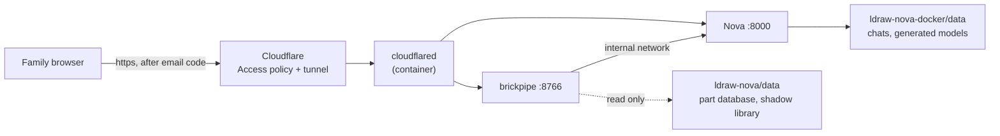

# Hosting brickpipe for the family

One home server runs LDraw Nova, brickpipe and a Cloudflare tunnel. Family
members open `https://bricks.<your domain>` from anywhere, sign in with a
one-time code sent to their email, and use the page exactly as on a laptop.
Nothing is opened on the router and nothing is reachable without that login.

This guide assumes a Proxmox host (any Debian/Ubuntu box with Docker works the
same from step 2) and a domain already on Cloudflare.

## What runs where



- **brickpipe** runs *locked*: the server decides where Nova and the part
  libraries are; the page hides those settings. Browsers only choose what
  goes into a run. The server can hold one Rebrickable key for everyone.
- **Nova** has no login of its own and holds your AI provider key, so it is
  never published to the network; the tunnel is the only way in, and the
  Access policy in front of the tunnel is the login.
- Links from brickpipe into Nova (the chat, the 3D viewer) use the public
  hostname, so they work from outside.
- Everyone shares one Nova: all chats and all runs are visible to all.
- **Whose AI account pays.** Nova's default model entry (your key or your
  Claude sign-in) is what runs unless a person brings their own: under
  Settings > AI account they can switch from "Use <host>'s AI account" to
  "Use my own key", pick a provider and model, and paste a key. brickpipe
  registers it in Nova as a model entry of its own; Nova keeps the key in
  its settings store on the server, and that person's runs are billed to
  it. "Forget" removes the entry again. Set `BRICKPIPE_HOST_NAME=Chris` so
  the toggle names you.

## 0. Before you start

- Cap the AI provider key Nova will use (OpenAI, Anthropic and OpenRouter all
  have a monthly spend limit). Nova spends it; a login in front is not a
  budget.
- Pick two hostnames under your domain, e.g. `bricks.example.com` and
  `nova.example.com`.
- The server needs about 4 GB RAM and 25 GB disk for this stack (Nova's
  image is 5 GB, the LDraw library 150 MB, runs are small).

## 1. A VM for it (Proxmox)

In the Proxmox web UI, Create VM:

| Setting | Value |
|---|---|
| Name | `brickpipe` |
| ISO | Debian 12 netinst (upload under local > ISO Images) |
| Machine / BIOS | defaults |
| Disk | 40 GB |
| CPU | 2 cores, type `host` |
| Memory | 4096 MB |
| Network | default bridge (vmbr0) |
| Options > Start at boot | yes |

Install Debian with defaults (one user, SSH server, no desktop). Give it a
fixed address on your router (DHCP reservation) so it does not move.

**Done when:** you can `ssh user@<vm-ip>` from your laptop.

## 2. Docker and the code

On the VM:

```bash
sudo apt update && sudo apt install -y git curl
curl -fsSL https://get.docker.com | sudo sh
sudo usermod -aG docker $USER && newgrp docker

mkdir -p ~/lego && cd ~/lego
git clone https://github.com/cgans/brickpipe.git
git clone --branch v0.6.0 https://github.com/anteloc/ldraw-nova.git
git clone --branch v0.6.0 https://github.com/anteloc/ldraw-nova-docker.git
```

**Done when:** `docker --version` prints a version and `ls ~/lego` shows the
three folders side by side.

## 3. The tunnel and the login (Cloudflare)

In <https://one.dash.cloudflare.com> (Zero Trust; the free plan is enough):

1. **Networks > Tunnels > Create a tunnel** (Cloudflared). Name it
   `brickpipe`. On the connector page, copy the **token** (the long string
   after `--token` in the install command); you do not need to run that
   command. Save.
2. In the tunnel's **Public Hostname** tab add two:
   - `bricks.example.com` → type HTTP, URL `brickpipe:8766`
   - `nova.example.com` → type HTTP, URL `nova:8000`
   (The container names resolve inside the compose network.)
3. **Access > Applications > Add an application > Self-hosted.** Name
   `brickpipe`, application domain `bricks.example.com`. Add a second
   domain in the same application for `nova.example.com`, so one login
   covers both. Session duration: 1 week or longer. Identity provider: the
   built-in **One-time PIN** is enough.
4. In that application add a policy: name `family`, action **Allow**, rule
   **Emails** = the family's email addresses (or **Emails ending in** your
   family domain). Save.

**Done when:** opening `https://bricks.example.com` in a private window asks
for an email and sends a code (the page behind it will fail until step 4;
that is fine). An email *not* on the list is refused.

## 4. Start it

```bash
cd ~/lego/brickpipe
cp deploy/.env.example deploy/.env
nano deploy/.env     # hostnames, TUNNEL_TOKEN, optional REBRICKABLE_API_KEY
docker compose -f deploy/docker-compose.yml --env-file deploy/.env up -d --build
```

The first build downloads about 5 GB for Nova and takes a while. Then:

```bash
docker compose -f deploy/docker-compose.yml logs -f brickpipe
```

should show the LDraw library downloading once (about 150 MB), then
`brickpipe 0.x is at http://localhost:8766 (listening on 0.0.0.0) [locked: hosted mode]`.

**Done when:**
- `https://nova.example.com` opens Nova. Add your AI provider key in its
  settings (or put it in `deploy/.env` and restart).
- `https://bricks.example.com` opens brickpipe; the header says `v0.x`;
  Settings shows the "This brickpipe is hosted" note and no Nova or library
  fields; under Build the status line reads "Nova is up".
- A test run from a prompt finishes with "Connectivity was checked" in its
  report (proves the library and Nova's database are mounted).

## 5. Day to day

- **Update brickpipe:** `cd ~/lego/brickpipe && git pull && docker compose -f deploy/docker-compose.yml --env-file deploy/.env up -d --build brickpipe`
- **Add a family member:** add their email to the Access policy. Nothing to
  restart.
- **Where things are:** runs in the `brickpipe-data` volume
  (`docker volume inspect brickpipe_brickpipe-data`), Nova's chats and
  models under `~/lego/ldraw-nova-docker/data`.
- **Logs:** `docker compose -f deploy/docker-compose.yml logs --tail 100 nova brickpipe tunnel`
- **Stop everything:** `docker compose -f deploy/docker-compose.yml down`

## If something goes wrong

| Symptom | Cause | Fix |
|---|---|---|
| Access page appears but then `502` or "unreachable" | tunnel container not connected, or hostname URL wrong | `docker compose logs tunnel`; check the Public Hostname URLs are `brickpipe:8766` and `nova:8000` |
| brickpipe opens but "Nova is not reachable" | Nova still building or crashed | `docker compose logs nova`; wait for the build; check the provider key |
| 3D viewer or "Open the Nova chat" shows a login page or fails | `nova.example.com` is not in the same Access application | add it as a second domain of the brickpipe application |
| Report says the connectivity check was skipped | library download failed or Nova data not mounted | `docker compose logs brickpipe`; check `~/lego/ldraw-nova/data/ldraw-info.db` exists |
| Someone outside the family can log in | policy too broad | tighten the Access policy to listed emails |

## Doing it without Proxmox or without Cloudflare

Any Linux box with Docker works from step 2. If you would rather not use
Cloudflare, Tailscale is the other sensible option: install it on the server
and on each family device, share the server into their tailnet, drop the
`tunnel` service and change the two `ports` lines to the server's Tailscale
address. There is then no login page; the tailnet membership is the login.
