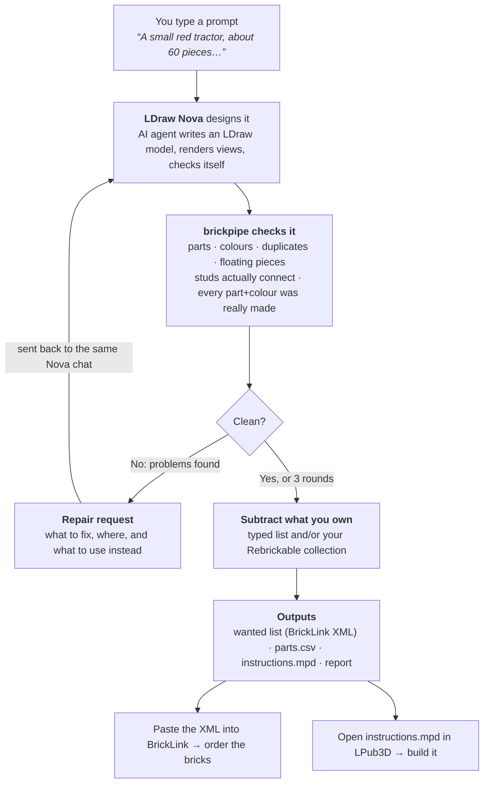

# How brickpipe works, from a sentence to a set on your table

brickpipe sits between an AI LEGO designer (LDraw Nova) and the real world
of bricks you can buy. You describe a model; what comes out is a model that
is checked to be buildable and buyable, a shopping list sized to what you
do not already own, and step-by-step instructions.

## The pieces

| Stage | Who does it | What it uses |
|---|---|---|
| Design | LDraw Nova's agent (your own AI provider key) | The LDraw part library, Nova's part database, renders of its own work |
| Check | brickpipe | Nova's database (part names, sizes, sockets), the LDraw library (studs), Rebrickable's API (was this part ever made in this colour, and how common is it) |
| Repair | Nova's agent again, in the same chat so it remembers the design | `feedback.md`: "Must fix" and "Should fix" lists with the submodel, part, colour and position of each problem and what to swap in |
| Subtract | brickpipe | Lines you typed (`part, colour, quantity`) and/or your Rebrickable sets and part lists |
| Deliver | brickpipe | BrickLink wanted-list XML, CSVs, an LDraw file with build steps |
| Order | you, on BrickLink | Want → Upload → "Upload BrickLink XML format", paste |
| Build | you, with LPub3D | File → Open `instructions.mpd`, page through the steps, export a PDF |

## What "checked" means

Nova is good at making things that look right in a render. brickpipe is
there for the things a render does not show:

- **Does the part exist, in that colour?** Rebrickable's catalogue says
  whether LEGO ever made that part in that colour, and in how many sets. A
  colour that was never made is an error; one made in only a couple of sets
  is a warning with commoner alternatives named.
- **Is it attached?** Each stud, pin and axle on each piece is matched to a
  socket on another piece. Anything not joined to the main body is reported
  by part and position, so the agent can move it.
- **Is the file sane?** Missing submodels, loops, pieces placed twice in the
  same spot, colour left unset, build steps too big to follow.

Every problem comes with a fix suggestion, and the whole list goes back to
the agent as one message. Three rounds is usually enough; the page shows each
round's piece count and problem count as it happens.

## Watching it happen

The page at <http://localhost:8766> shows, live: what the agent is saying,
each tool it runs and its output, the images it renders and looks at, an
elapsed timer, and a 3D view of each round's model. You can close the page
and come back; runs keep going. Nothing here needs a terminal once it is
set up.

## Behind a flag

A price estimate from BrickLink's price guide is built but off by default,
because BrickLink only issues API keys to seller accounts. See the README.

## Setting it up once

Windows: [testing-on-windows.md](testing-on-windows.md). Short version:
Python, Docker Desktop, two `git clone`s for Nova, `docker compose up`, then
double-click `brickpipe-ui.cmd`. Add your Rebrickable key in the page's
Settings and press the button to fetch the LDraw library.
